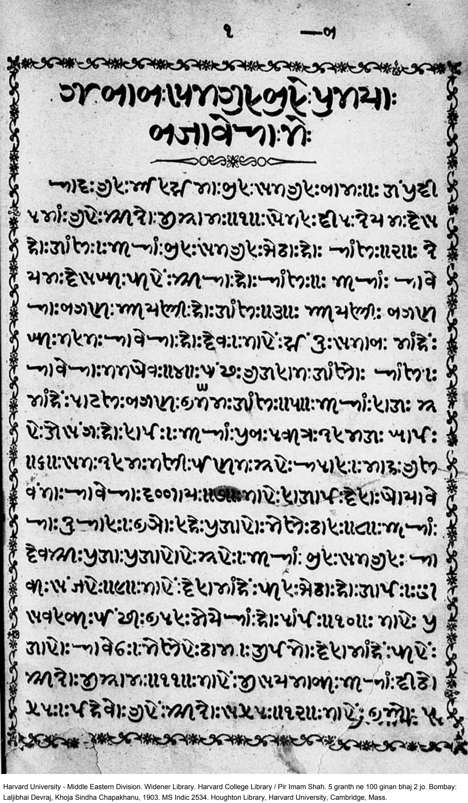
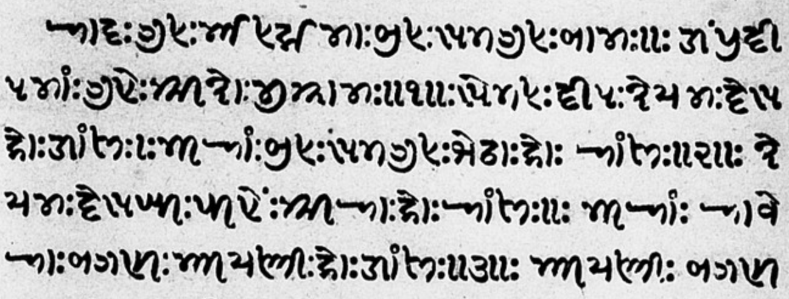
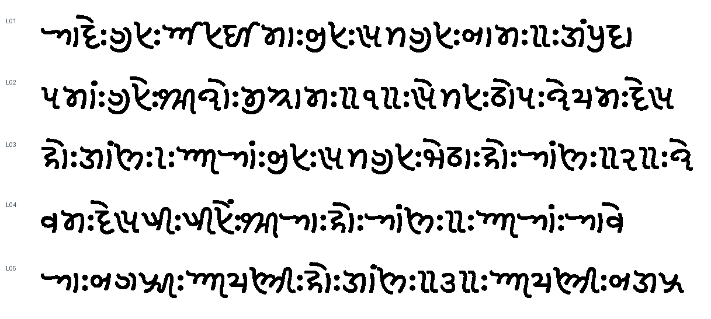

# Khojki OCR

A small OCR pipeline for scanned Khojki pages. It finds text lines, groups characters with their marks, and uses a **multi-head convolutional neural network** to produce **UTF-8 Khojki**. It runs locally on CPU.

The five-line example below has **8.29% character error rate (CER)**. The [one-page retrospective](retro.pdf) covers the main experiments, errors and next steps.

## Run it

Tested with Python 3.13 on macOS (Apple Silicon). From the downloaded repository folder, install the package:

```sh
python3 -m venv .venv
source .venv/bin/activate
python -m pip install .
```

The trained weights are included. Installation downloads the Python dependencies; recognition runs locally on CPU.

Process an entire PDF and save the recognized text:

```sh
khojki-ocr --pdf /path/to/document.pdf > output.txt
```

This runs every step: PDF rendering, preprocessing, line detection, character segmentation, the CNN and Unicode assembly. `output.txt` contains only UTF-8 Khojki text, with one line per detected line and a blank line between PDF pages. Add `--pages 22-24` to process selected pages; page numbers start at 1.

For a page image, replace the PDF argument with `--image`. PNG, JPEG, TIFF and other image formats supported by OpenCV are accepted:

```sh
khojki-ocr --image /path/to/page.png > output.txt
```

To try the included example:

```sh
khojki-ocr --image examples/page-022.png > example-output.txt
```

The same pipeline handles your own files; no reference transcription or manual line coordinates are needed. Image loading accepts other documents too, but recognition has only been evaluated on printed Khojki.

For optional crop images, predictions and timings, add `--output runs/inspection --trace`. This directory must be new. Diagnostics go to that directory and stderr, leaving stdout as plain text.

A run that needs review still writes any recognized text, reports a warning on stderr and exits with status 2. A successful run exits with status 0.

## Page, excerpt and output

The main example is **page 22 of the supplied PDF**, from the 1903 printed book. Click the image to see the full page.

<a href="examples/page-022.png"></a>

These are the five consecutive lines used for the main evaluation:



Below is the pipeline's output, **with its mistakes left in**. The image uses Noto Sans Khojki. The actual output file is UTF-8 text.



[The actual UTF-8 output](results/L01-L05.txt). The image above displays that same text using the bundled [Noto Sans Khojki font](src/khojki_ocr/assets/NotoSansKhojki-Regular.ttf). Some viewers show gaps or boxes without a suitable Khojki font; the text file itself contains the characters.
