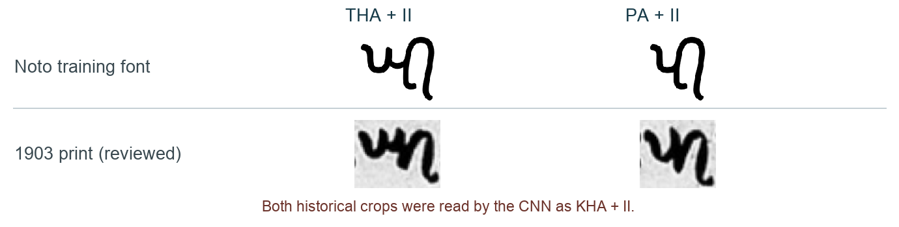

# Khojki OCR: technical retrospective

**Approach.** I first separate ink from the page background and find text lines. Within each line, I group strokes with nearby dots and vowel signs, then fit each character crop into a 48 x 48 image. A small convolutional neural network (CNN) predicts the base letter, vowel sign and other marks separately. Checks on mark position help distinguish them from punctuation before the predictions are assembled into UTF-8 Khojki. I trained on 22,656 artificial images rendered with Noto Sans Khojki, adding rotations, stretching, blur and changes in stroke thickness. I selected the saved model using synthetic images kept out of training. Historical scans were not training data, but their errors guided pipeline changes.

**Results.** The main five lines from PDF page 22 scored **16/193 edits = 8.29% CER**: 14 substitutions, one deletion and one insertion.

**Errors by stage.** On the main five lines, inspection assigns 0 edits to line detection, 1 to crop cleanup, 15 to recognition and 0 to Unicode mapping. For example, DDDA + II became DDDA + AA despite the complete vowel stroke being present. Removing a speck restored HA from GHA with the same CNN, though renormalization also changed its scale.

**Experiments.** I tried making errors on letters with fewer training examples count more during training, hoping to improve their recognition. This increased errors: average CER rose from 18.73% to 19.73%. In a separate test, I removed an early step that shrinks the image inside the CNN, hoping to preserve tiny strokes and marks. That raised CER to 21.66%. Both tests used the same 13 development lines, training data, crops and number of training passes, with results averaged over three training runs. I kept the original settings.

I also fixed a bug in the artificial images: overlapping strokes sometimes erased each other. After retraining, CER on a separate seven-line comparison rose from 16.43% to 22.34%, again averaged over three runs. I kept this fix because it made the training images correct, but it showed that cleaner font images alone did not improve recognition of these historical scans.

**Encoding.** Unicode assigns an ID to each character. I write vowel signs after their base: AA is U+1122C, II is U+1122E and O is U+11232. The colon-like word separator is Khojki U+1123A; digits use Gujarati U+0AE6-U+0AEF. Code checks UTF-8 round trips, allowed characters and vowel placement. Rendering the output and comparing it with the scan checks the reading itself: valid Unicode can still name the wrong letter.

**Bottleneck.** The missing dataset is reviewed historical base-plus-mark crops. The comparison below suggests why one font is insufficient: two different historical forms collapse to the same prediction. I would start with 100-200 labelled lines emphasizing PA/THA/KHA and detached signs, then use learning curves toward 500-1,000 lines across books. These are estimates. Reserve entire books before tuning and test body-relative mark features. Handwriting needs writer-separated labels and revised segmentation or a line recognizer.

**Scale.** Three pages took 6.80 seconds on CPU including startup and trace export, or 1.93 seconds/page after imports: about 91 seconds for 47 comparable printed pages. Difficult layouts were slower, reaching 3.37 seconds for line layout alone.

**AI tools.** AI assisted coding and draft transcription. An LLM read BA + II at the start of line 2's third group. Checking the crossing base stroke against the chart supported KA + II, and visual review corrected the reference. I kept these reference corrections separate from model predictions.
